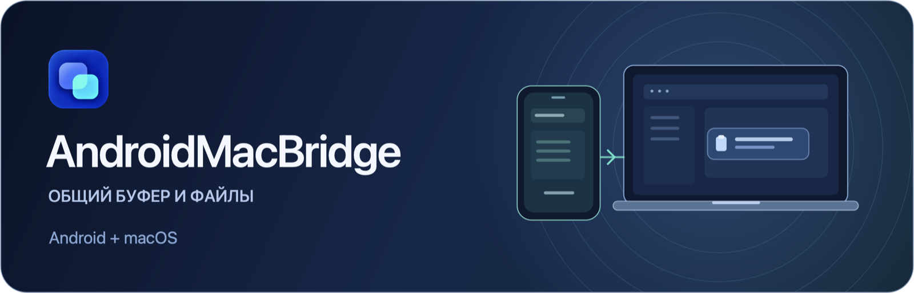
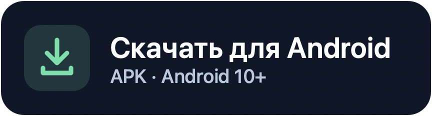

<h1 align="center">
  
</h1>

<strong>Скопируй здесь, вставь там.</strong> Отправляй файлы в обе стороны.

  
  &nbsp;
  

  <a href="https://github.com/Seferaki/AndroidMacBridge/releases/tag/v1.0.0">Выпуск 1.0.0</a>
  · <a href="#установка">Установка</a>
  · <a href="https://github.com/Seferaki/AndroidMacBridge/releases">Все версии</a>

---

## Как это выглядит

| Буфер с Android на Mac | Файл с Mac на Android |
| :--- | :--- |
| Нажми **«Копировать»** на телефоне, затем **⌘V** на Mac. | Выбери файл в Finder и нажми **«Поделиться» → AndroidMacBridge**. |

## Возможности

- **Общий буфер.** Текст, ссылки и изображения передаются в обе стороны. Способ отправки с Android можно выбрать в настройках.
- **Передача файлов.** Отправляй через системное меню или перетаскивай файлы на Mac. Для каждого файла виден прогресс, передачу можно отменить. Автоприём включается отдельно.
- **Wi‑Fi и Bluetooth.** Можно обмениваться напрямую в общей сети или включить Bluetooth на обоих устройствах, если сети разные. Данные передаются по защищённому соединению.
- **История для каждой пары.** Передачи и записи текстового буфера хранятся отдельно для каждой связки телефона и Mac.

## Установка

1. **Android.** Открой скачанный APK. Если Android попросит, разреши установку из приложения, в котором открыл файл.
2. **Mac.** Распакуй ZIP для Apple Silicon и Intel, перенеси **AndroidMacBridge.app** в «Программы». При первом запуске разреши доступ к локальной сети.
3. **Сопряжение.** Подключи устройства к одной Wi‑Fi сети, отсканируй QR-код с экрана Mac и подтверди запрос на Mac.
4. **Общий буфер и Bluetooth.** По желанию включи нужную функцию в настройках обоих устройств. На Redmi 15 автокопирование со штатной клавиатурой проверено в Telegram, WhatsApp и «Заметках».

<strong>Если macOS блокирует первый запуск</strong>

Сборка Mac без нотариального заверения Apple. После попытки запуска открой **Системные настройки → Конфиденциальность и безопасность → Всё равно открыть**. [Инструкция Apple](https://support.apple.com/ru-ru/102445)

<strong>Если уже установлена тестовая версия Android</strong>

У выпуска другой ключ подписи. Android попросит удалить тестовую версию перед установкой. При удалении сбросятся сопряжение, настройки и локальная история приложения. [Как Android проверяет обновления](https://developer.android.com/google/play/app-updates)

## Обратная связь

[Сообщить о проблеме](https://github.com/Seferaki/AndroidMacBridge/issues/new)
